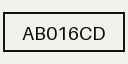
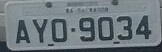

# CCT-S license plate OCR: experiments and reproducible workflows

[Download the public energy-meter example](notebooks/00_download_ocr_example.ipynb), then open [02_train.ipynb](notebooks/02_train.ipynb). Open the training notebook and set `USE_ENERGY_METER = True`. The example uses a CCT alphabet that includes the decimal point. The downloader prepares the two CSV annotations CCT expects.

[Train in Jupyter](notebooks/02_train.ipynb) · [Copy the TensorRT runtime](notebooks/06_tensorrt.ipynb). The notebooks expose the training loop, predictions, and automatic engine build.

## Compare the tested TensorRT profiles

### Price tags


Expected output is `107.25 DH`. On real tags, cents can be raised or smaller, a currency symbol can split the amount, and unit prices can compete with the headline price. [Open a real benchmark price tag](https://prices.openfoodfacts.org/img/price-tags/000/123/000123564.webp)


| Model | Params | Input | Corrected tags | Public photos | Latency¹ | GPU¹ |
|---|---:|---|---:|---:|---:|---:|
| [WATERec](https://github.com/algofly-oss/waterec-ocr-training) rank-192 | 20.84M | ≤896 patches | **163/206 (79.13%)** | **49/71 (69.01%)** | 1.17 ms | 724 MiB |
| [PP-OCRv6](https://github.com/algofly-oss/ppocrv6-ocr-training) Medium | 15.58M | 128×320 | **163/206 (79.13%)** | 6/71 (8.45%) | 0.77 ms | 656 MiB |
| [PP-OCRv6](https://github.com/algofly-oss/ppocrv6-ocr-training) Small | 3.04M | 128×320 | 160/206 (77.67%) | 13/71 (18.31%) | **0.60 ms** | 652 MiB |
| [Florence-2](https://github.com/algofly-oss/florence2-ocr-training) Base | 231.41M | 384×384 | 157/206 (76.21%) | 3/71 (4.23%) | 4.95 ms | 1,452 MiB |
| [PARSeq](https://github.com/algofly-oss/parseq-ocr-training) Fast Tiny | 6.05M | 48×192 | 44/206 (21.36%) | 2/71 (2.82%) | 0.89 ms | 688 MiB |

¹ Mean from decoded RGB on the corrected price crops, RTX 5090, batch one. GPU memory is the sampled process peak. Ranking prioritizes corrected exact matches, then public exact matches. The corrected set includes 68 provisional labels.

### License plates



Expected output is `AB016CD`. On real crops the reader must keep the character order across unfamiliar fonts, stacked rows, glare, and blur.



The international evaluation uses this crop from the OpenALPR benchmark. The recognizer receives the cropped plate and the expected text is `AYO9034`. [Source photograph](https://github.com/openalpr/benchmarks/blob/9790ed20d475be1e940a7e2a3f492a97c2ebed9b/endtoend/br/AYO9034.jpg)

| Model | Params | Input | Reviewed unseen | Local validation | Latency² | GPU² |
|---|---:|---|---:|---:|---:|---:|
| [WATERec](https://github.com/algofly-oss/waterec-ocr-training) speculative | 27.51M | ≤512 patches | **879/984 (89.33%)** | **2,476/2,693 (91.94%)** | 1.07 ms | 700 MiB |
| [Florence-2](https://github.com/algofly-oss/florence2-ocr-training) Base | 231.41M | 224×224 | 857/984 (87.09%) | 2,381/2,693 (88.41%) | 4.88 ms | 1,130 MiB |
| [PARSeq](https://github.com/algofly-oss/parseq-ocr-training) Fast Tiny | 6.05M | 48×192 | 715/984 (72.66%) | 2,377/2,693 (88.27%) | 0.69 ms | 682 MiB |
| [CCT-S](https://github.com/algofly-oss/cct-ocr-training) | 0.98M | 64×128 | 628/984 (63.82%) | 2,226/2,693 (82.66%) | 0.85 ms | 542 MiB |
| [PP-OCRv6](https://github.com/algofly-oss/ppocrv6-ocr-training) Medium | 15.58M | Height 48 | 626/984 (63.62%) | 2,339/2,693 (86.85%) | 0.76 ms | 650 MiB |

² Mean from decoded RGB, RTX 5090, batch one. WATERec and Florence-2 timing used the 984 reviewed crops. Other timings come from separate workloads. Ranking uses reviewed unseen exact matches.

All accuracy scores count complete exact strings. Use WATERec when unfamiliar plates or price layouts matter most. PP-OCRv6 Small is the fastest tested option on the corrected price crops. Expand the detailed tables below for more variants, encoded timings, and protocol notes.

<details>
<summary>All benchmark variants and historical tables</summary>

<!-- ocr-family-comparison:start -->

## Choose an OCR model

### Price-tag OCR

#### Price development

| Rank | Model family | Variant | Parameters | Input H×W | Exact match | RGB / encoded mean | GPU peak |
|---:|---|---|---:|---|---:|---:|---:|
| 1 | [Florence-2](https://github.com/algofly-oss/florence2-ocr-training) | Base, optimized TensorRT price | 231.41M | 384×384 | 106/144 (73.61%) | 5.37 / 5.62 ms | 1,454 MiB |
| 1 | [WATERec](https://github.com/algofly-oss/waterec-ocr-training) | R2048, price | 26.12M | 128×256 | 106/144 (73.61%) | 1.97 / 2.20 ms | 716 MiB |
| 3 | [Florence-2](https://github.com/algofly-oss/florence2-ocr-training) | Base, PyTorch price | 231.41M | 384×384 | 105/144 (72.92%) | 35.37 / 35.53 ms | 1,768 MiB |
| 4 | [PP-OCRv6](https://github.com/algofly-oss/ppocrv6-ocr-training) | Medium mixed, price | 15.58M | 128×320 | 104/144 (72.22%) | 0.88 / 1.09 ms | 654 MiB |
| 4 | [PP-OCRv6](https://github.com/algofly-oss/ppocrv6-ocr-training) | Medium FP32, price | 15.58M | 128×320 | 104/144 (72.22%) | 1.41 / 1.69 ms | 588 MiB |
| 6 | [CCT](https://github.com/algofly-oss/cct-ocr-training) | CCT64, price | 0.98M | 64×128 | 66/144 (45.83%) | 0.75 / 0.94 ms | 542 MiB |
| 7 | [CCT](https://github.com/algofly-oss/cct-ocr-training) | CCT128, price | 1.15M | 128×256 | 65/144 (45.14%) | — | — |

#### Broader corrected price

| Rank | Model family | Variant | Parameters | Input H×W | Exact match | RGB / encoded mean | GPU peak |
|---:|---|---|---:|---|---:|---:|---:|
| 1 | [WATERec](https://github.com/algofly-oss/waterec-ocr-training) | Original TensorRT | 26.12M | ≤1,024 patches | 167/206 (81.07%) | 1.11 / 1.31 ms | 702 MiB |
| 2 | [WATERec](https://github.com/algofly-oss/waterec-ocr-training) | R2048, price | 26.12M | 128×256 | 163/206 (79.13%) | 1.97 / 2.20 ms | 716 MiB |
| 2 | [PP-OCRv6](https://github.com/algofly-oss/ppocrv6-ocr-training) | Currency-adapted TensorRT | 15.58M | 128×320 | 163/206 (79.13%) | 0.77 / 1.00 ms | 656 MiB |
| 4 | [WATERec](https://github.com/algofly-oss/waterec-ocr-training) | Photo-adapted TensorRT | 26.12M | 896 patches | 162/206 (78.64%) | 1.07 / 1.29 ms | 696 MiB |
| 5 | [PP-OCRv6](https://github.com/algofly-oss/ppocrv6-ocr-training) | Currency-adapted native | 15.58M | 128×320 | 161/206 (78.16%) | 5.43 / 5.43 ms | 724 MiB |
| 6 | [PP-OCRv6](https://github.com/algofly-oss/ppocrv6-ocr-training) | Small, currency-adapted TensorRT | 3.04M | 128×320 | 160/206 (77.67%) | 0.60 / 0.82 ms | 652 MiB |
| 7 | [Florence-2](https://github.com/algofly-oss/florence2-ocr-training) | Base, PyTorch price | 231.41M | 384×384 | 159/206 (77.18%) | 33.37 / 35.30 ms | 1,768 MiB |
| 8 | [Florence-2](https://github.com/algofly-oss/florence2-ocr-training) | Base, optimized TensorRT price | 231.41M | 384×384 | 157/206 (76.21%) | 4.95 / 5.22 ms | 1,452 MiB |
| 9 | [WATERec](https://github.com/algofly-oss/waterec-ocr-training) | Rank 128, photo-adapted TensorRT | 17.87M | 896 patches | 154/206 (74.76%) | 1.08 / 1.34 ms | 696 MiB |
| 10 | [PARSeq](https://github.com/algofly-oss/parseq-ocr-training) | Fast Tiny, TensorRT price | 6.05M | 48×192 | 44/206 (21.36%) | 0.89 / 1.11 ms | 688 MiB |

#### Unseen retail photos

The three public photo cohorts contain 71 scorable references. Rows are ordered by full-string exact matches across the three cohorts.

| Model and TensorRT variant | Parameters | Input | Earlier | Confirmation | Fresh | Total exact | Tiled WebP mean | Tiled GPU peak |
|---|---:|---|---:|---:|---:|---:|---:|---:|
| [WATERec](https://github.com/algofly-oss/waterec-ocr-training) rank 192 + paired-format head (diagnostic) | 20.84M | ≤896 patches | 23/31 (74.19%) | 15/23 (65.22%) | 11/17 (64.71%) | 49/71 (69.01%) | 2.95–5.36 ms | 702 MiB |
| [WATERec](https://github.com/algofly-oss/waterec-ocr-training) full + paired-format head (experimental) | 26.15M | ≤896 patches | 23/31 (74.19%) | 14/23 (60.87%) | 10/17 (58.82%) | 47/71 (66.20%) | 2.98–5.43 ms | 702 MiB |
| [WATERec](https://github.com/algofly-oss/waterec-ocr-training) full + formatting head (experimental) | 26.15M | ≤896 patches | 23/31 (74.19%) | 9/23 (39.13%) | 11/17 (64.71%) | 43/71 (60.56%) | 2.92–5.33 ms | 702 MiB |
| [WATERec](https://github.com/algofly-oss/waterec-ocr-training) rank 128 + formatting head (experimental) | 17.89M | ≤896 patches | 18/31 (58.06%) | 9/23 (39.13%) | 8/17 (47.06%) | 35/71 (49.30%) | 2.95–5.25 ms | 702 MiB |
| [WATERec](https://github.com/algofly-oss/waterec-ocr-training) full, photo-adapted | 26.12M | ≤896 patches | 18/31 (58.06%) | 5/23 (21.74%) | 5/17 (29.41%) | 28/71 (39.44%) | — | — |
| [WATERec](https://github.com/algofly-oss/waterec-ocr-training) rank 128, photo-adapted | 17.87M | ≤896 patches | 17/31 (54.84%) | 7/23 (30.43%) | 4/17 (23.53%) | 28/71 (39.44%) | — | — |
| [PP-OCRv6](https://github.com/algofly-oss/ppocrv6-ocr-training) Small, currency-adapted | 3.04M | 128×320 | 8/31 (25.81%) | 2/23 (8.70%) | 3/17 (17.65%) | 13/71 (18.31%) | — | — |
| [PP-OCRv6](https://github.com/algofly-oss/ppocrv6-ocr-training) Medium, currency-adapted | 15.58M | 128×320 | 3/31 (9.68%) | 0/23 (0.00%) | 3/17 (17.65%) | 6/71 (8.45%) | — | — |
| [Florence-2](https://github.com/algofly-oss/florence2-ocr-training) Base, optimized | 231.41M | 384×384 | 3/31 (9.68%) | 0/23 (0.00%) | 0/17 (0.00%) | 3/71 (4.23%) | — | — |

The timing range spans the three cohort means from encoded bytes in RAM at batch one. The paired-format head reads the visible separator and currency from image features. The full paired model matched stock at 162/206 on corrected crops. The rank-192 diagnostic read 163/206. Its encoder engine was 23% smaller and averaged 1.174 ms from decoded crops versus 1.135 ms for the full paired model. Preparing lossless, model-sized BMPs at ingestion preserved all 71 predictions and ran in 1.07–1.13 ms at 698 MiB. The prepared-input timings exclude ingest conversion.

#### Historical price

| Rank | Model family | Variant | Parameters | Input H×W | Exact match | RGB / encoded mean | GPU peak |
|---:|---|---|---:|---|---:|---:|---:|
| 1 | [WATERec](https://github.com/algofly-oss/waterec-ocr-training) | Compact restart2, static batch 1 | 17.91M | 2,048 → 512 selected patches | 161/206 (78.16%) | 1.39 ms / — | 708 MiB |
| 1 | [PP-OCRv6](https://github.com/algofly-oss/ppocrv6-ocr-training) | Medium, historical price | 15.58M | 128×320 | 161/206 (78.16%) | 1.18 ms / — | 654 MiB |
| 3 | [WATERec](https://github.com/algofly-oss/waterec-ocr-training) | R rank128 | 17.86M | 2,048 patches | 159/206 (77.18%) | 1.62 ms / — | 714 MiB |
| 4 | [WATERec](https://github.com/algofly-oss/waterec-ocr-training) | R1024 | 26.12M | 88×180 | 154/206 (74.76%) | 1.09 ms / — | 700 MiB |
| 5 | [WATERec](https://github.com/algofly-oss/waterec-ocr-training) | R2048 | 26.12M | 128×256 | 153/206 (74.27%) | 1.68 ms / — | 716 MiB |
| 6 | [WATERec](https://github.com/algofly-oss/waterec-ocr-training) | R512 | 26.12M | 64×128 | 149/206 (72.33%) | 0.82 ms / — | 688 MiB |
| 7 | [PARSeq](https://github.com/algofly-oss/parseq-ocr-training) | Base, price | 23.98M | 64×256 | 148/206 (71.84%) | — | — |
| 8 | [PARSeq](https://github.com/algofly-oss/parseq-ocr-training) | Tiny, native BF16 price | 6.09M | 64×256 | 118/206 (57.28%) | — | — |
| 9 | [PARSeq](https://github.com/algofly-oss/parseq-ocr-training) | Fast Tiny, price | 6.05M | 48×192 | 112/206 (54.37%) | 0.89 / 1.09 ms | 688 MiB |

### License-plate recognition (LPR)

#### LPR development

| Rank | Model family | Variant | Parameters | Input H×W | Exact match | RGB / encoded mean | GPU peak |
|---:|---|---|---:|---|---:|---:|---:|
| 1 | [WATERec](https://github.com/algofly-oss/waterec-ocr-training) | Adapted 512-patch TensorRT, plates | 26.12M | 64×128 dev | 1,075/1,167 (92.12%) | 1.27 / 1.44 ms | 686 MiB |
| 2 | [PP-OCRv6](https://github.com/algofly-oss/ppocrv6-ocr-training) | Medium height 128, plates | 15.58M | 128×320 bound | 1,027/1,167 (88.00%) | 0.96 / 1.09 ms | 654 MiB |
| 3 | [PP-OCRv6](https://github.com/algofly-oss/ppocrv6-ocr-training) | Medium height 48, plates | 15.58M | Height 48 | 1,001/1,167 (85.78%) | 0.76 / 0.94 ms | 650 MiB |
| 4 | [CCT](https://github.com/algofly-oss/cct-ocr-training) | [CCT-S](https://github.com/algofly-oss/cct-ocr-training), plates | 0.98M | 64×128 | 953/1,167 (81.66%) | 0.85 / 1.03 ms | 542 MiB |

#### LPR validation

| Rank | Model family | Variant | Parameters | Input H×W | Exact match | RGB / encoded mean | GPU peak |
|---:|---|---|---:|---|---:|---:|---:|
| 1 | [WATERec](https://github.com/algofly-oss/waterec-ocr-training) | Adapted 512-patch TensorRT, plates | 26.12M | 64×128 dev | 2,477/2,693 (91.98%) | 1.27 / 1.44 ms | 686 MiB |
| 2 | [WATERec](https://github.com/algofly-oss/waterec-ocr-training) | Speculative TensorRT with orientation correction | 27.76M | ≤512 patches | 2,476/2,693 (91.94%) | — | — |
| 3 | [WATERec](https://github.com/algofly-oss/waterec-ocr-training) | RS, plates | 26.12M | Aspect-preserving, ≤512 patches | 2,475/2,693 (91.90%) | 1.26 / 2.26 ms | 694 MiB |
| 4 | [Florence-2](https://github.com/algofly-oss/florence2-ocr-training) | Base, optimized TensorRT plates | 231.41M | 224×224 | 2,381/2,693 (88.41%) | — | — |
| 5 | [PARSeq](https://github.com/algofly-oss/parseq-ocr-training) | Fast Tiny, plates | 6.05M | 48×192 | 2,377/2,693 (88.27%) | 0.69 / 1.66 ms | 682 MiB |
| 6 | [PP-OCRv6](https://github.com/algofly-oss/ppocrv6-ocr-training) | Medium height 128, plates | 15.58M | 128×320 bound | 2,368/2,693 (87.93%) | 0.96 / 1.09 ms | 654 MiB |
| 7 | [PP-OCRv6](https://github.com/algofly-oss/ppocrv6-ocr-training) | Medium height 48, plates | 15.58M | Height 48 | 2,339/2,693 (86.85%) | 0.76 / 0.94 ms | 650 MiB |
| 8 | [CCT](https://github.com/algofly-oss/cct-ocr-training) | [CCT-S](https://github.com/algofly-oss/cct-ocr-training), plates | 0.98M | 64×128 | 2,226/2,693 (82.66%) | 0.85 / 1.03 ms | 542 MiB |

#### Reviewed unseen plates

| Rank | Model family | Variant | Parameters | Input H×W | Exact match | RGB / encoded mean | GPU peak |
|---:|---|---|---:|---|---:|---:|---:|
| 1 | [WATERec](https://github.com/algofly-oss/waterec-ocr-training) | Speculative TensorRT | 27.51M | ≤512 patches | 879/984 (89.33%) | 1.07 / 2.71 ms | 700 MiB |
| 2 | [WATERec](https://github.com/algofly-oss/waterec-ocr-training) | Speculative TensorRT with orientation correction | 27.76M | ≤512 patches | 878/984 (89.23%) | 1.17 / 2.84 ms | 700 MiB |
| 3 | [Florence-2](https://github.com/algofly-oss/florence2-ocr-training) | Base, optimized TensorRT plates | 231.41M | 224×224 | 857/984 (87.09%) | 4.88 / 6.56 ms | 1,130 MiB |
| 4 | [WATERec](https://github.com/algofly-oss/waterec-ocr-training) | Adapted 512-patch TensorRT, plates | 26.12M | 64×128 dev | 855/984 (86.89%) | 1.27 / 1.44 ms | 686 MiB |
| 5 | [WATERec](https://github.com/algofly-oss/waterec-ocr-training) | Rank 128, TensorRT plates | 17.86M | ≤512 patches | 849/984 (86.28%) | 1.18 / 2.82 ms | 696 MiB |
| 6 | [PARSeq](https://github.com/algofly-oss/parseq-ocr-training) | Fast Tiny, plates | 6.05M | 48×192 | 715/984 (72.66%) | 0.69 / 1.66 ms | 682 MiB |
| 7 | [CCT](https://github.com/algofly-oss/cct-ocr-training) | [CCT-S](https://github.com/algofly-oss/cct-ocr-training), plates | 0.98M | 64×128 | 628/984 (63.82%) | 0.85 / 1.03 ms | 542 MiB |
| 8 | [PP-OCRv6](https://github.com/algofly-oss/ppocrv6-ocr-training) | Medium height 48, plates | 15.58M | Height 48 | 626/984 (63.62%) | 0.76 / 0.94 ms | 650 MiB |
| 9 | [PP-OCRv6](https://github.com/algofly-oss/ppocrv6-ocr-training) | Medium height 128, plates | 15.58M | 128×320 bound | 534/984 (54.27%) | 0.96 / 1.09 ms | 654 MiB |

The optional RGB-array API for speculative WATERec averaged 0.981 ms on the same 984 upright plates, preserving all output strings at 700 MiB. BMP reached 1.050 ms from in-memory bytes with about twice the original PNG payload.

- **Fast recognition on a tight latency budget:** start with PP-OCRv6. Its currency-adapted TensorRT build reached 163/206 in the corrected-crop comparison.
- **Unseen plate layouts:** start with WATERec. The 512-patch speculative checkpoint reached 879/984 on reviewed unseen crops. With orientation correction it read 880/984 at 90°, 880/984 at 180°, and 881/984 at 270°.
- **Smallest model:** CCT-S is about 1M parameters. Use it when the input resembles its training distribution.
- **Custom text selection and ordering:** benchmark Florence-2 on your own annotation policy. Its faster TensorRT path lost two exact matches versus PyTorch on the broader price-tag evaluation.

Timings are batch 1 on an RTX 5090, with preprocessing, recognition and text decoding included. Encoded scope includes image decoding and may include file reads in historical runs. GPU peak is driver-accounted memory. Exact match uses the literal full string. The LPR validation table includes separate WATERec checkpoints identified in the variant column. Compare accuracy within the same label version and split: historical PARSeq price scores use an earlier label policy, and the broader corrected price cohort includes 68 provisional labels. A dash means a comparable result is unavailable. The corrected price timings use the same 206 images for PP-OCRv6, the photo-adapted WATERec profiles, Florence-2 and Fast Tiny. The two original WATERec rows retain development-crop timings. The reviewed unseen plate timings for speculative WATERec, rank-128 WATERec and Florence-2 use the same 984 images. Other timing rows use their original benchmark workloads. The latest Florence values are research measurements; see its repository for the executable versions.

<!-- ocr-family-comparison:end -->

</details>

A compact TensorFlow/Keras plate recognizer, with training, ONNX export, and TensorRT evaluation recipes. This repository records measured reference results and provides fictional image/text data to exercise the workflow. Dummy data is not an OCR benchmark.

## Measured reference results

The task model has **977,510 learned parameters**, 432 fixed blur elements, RGB input **64 × 128**, **15 character slots**, and **37 classes** (`0–9`, `A–Z`, padding `_`). These results describe an existing task checkpoint, not a newly trained dummy model.

| Batch | Batch latency, mean | Throughput | Sampled process GPU memory |
|---:|---:|---:|---:|
| 1 | 0.4474 ms | 2,235 images/s | 742 MiB |
| 32 | 2.5137 ms | 12,730 images/s | 742 MiB |

Scope: 256 reference plate crops, five warmups and three passes; predecoded RGB through preprocessing, transfer, model execution and decoding. The engine and allocations supported batch 32. GPU memory includes the CUDA context and is a sampled process peak. Reference-suite hardware context: NVIDIA GeForce RTX 5090, driver 595.58.03. The individual historical batch artifacts omit the GPU name and measurement date, so their date is unknown. These are not disk-to-text timings; the timing cohort is not a full-test accuracy denominator. See [the complete batch measurements](results/reference_metrics.json). Reproduce on your hardware before comparing numbers; new exports do not inherit this qualification.

The upstream generic `cct_s_v2_global.keras` is a **different configuration**: 1,060,907 parameters, 10 plate slots and a region branch. Compatible pretrained weights can initialize the 15-slot model, but this is not an exact whole-model restore. Upstream training uses `skip_mismatch=True`; inspect loading warnings. The historical 39-class price model has 977,736 learned parameters and is distinct from this public 37-class workflow.

A fresh literal replay of the historical plate engine verifies **2,315/2,693 (85.96%)** validation and **644/984 (65.45%)** on a separate reviewed unseen cohort. Raw strings were saved before scoring. This accuracy replay is separate from the older256-image timing experiment and does not qualify newly trained weights, the current public preprocessing/decoder or a clean new ALPR training baseline. The historical engine’s training ancestry differs from a prospective clean baseline.

### Separate corrected-price research checkpoints

These are **research models, not public plate presets**. They use676 fitting images and all 144 development images under the full-amount-plus-visible-currency convention, including45 unresolved labels. Literal exact preserves every case, symbol, space and sequence position.

| Research checkpoint | Learned parameters / classes | Input H×W | Literal exact /144 | RGB / encoded ms | Inference GPU MiB |
|---|---|---|---:|---:|---:|
| CCT64 | 977,962 /41 | 64×128 | 66 (45.83%) | 0.746 /0.937 | 542 |
| CCT128 | 1,149,994 /41 | 128×256 | 65 (45.14%) | Not measured | Not measured |

CCT64’s current TensorRT run reproduced all 144 native strings and token sequences. RTX5090/staticB1 measurements use eight warmups and three full144-image passes in separate RGB/encoded processes. RGB includes preprocessing, transfer, model inference and host text; encoded adds image-byte decoding. File I/O, loading/building and warmup are excluded. Its research pipeline uses **Pillow BICUBIC stretching and removal of every PAD slot**. This repository’s default evaluator instead uses **OpenCV linear resizing and stops at the first PAD**. Do not transfer these research accuracy/timing results to the public 37-class decoder or to the historical 39-class price checkpoint.

CCT128 selected epoch16 and ended at 59/144; no gain over CCT64 was observed. Microbatching and dropout RNG partition also differ, so this is not an isolated resolution ablation. Its 3,072 MiB measurement is training memory, not inference memory. The clean38-class ALPR research checkpoint completed20 epochs and scores953/1,167 (81.66%); its own B1 TensorRT runtime measures0.846 ms RGB /1.032 ms encoded,542 MiB. This includes the literal quote and is separate from the packaged37-class workflow. Research uses PIL BICUBIC and removes all PAD slots; the public workflow uses linear resize and stops at the first PAD, so these results are not assigned to the public default. See the [full exact-only comparison](https://github.com/algofly-oss/waterec-ocr-training/blob/main/docs/model_comparison.md) and [PDF](https://github.com/algofly-oss/waterec-ocr-training/blob/main/docs/reports/ocr_comparison_2026-11-17.pdf) for separate current and historical cohorts. Historical private evidence is preserved; older selection ancestry is not retroactively relabeled as the current literal-only reporting policy.

See [capabilities across layouts, rotations and domains](docs/capabilities.md) for measured limits and comparison scopes.

## Workflow

Run the clean notebooks in order:

0. [Environment](notebooks/00_environment.ipynb)
1. [Dummy data and image/TXT conversion](notebooks/01_dummy_dataset.ipynb)
2. [Native CCT-S training](notebooks/02_train.ipynb)
3. [Native Keras evaluation](notebooks/03_native_inference.ipynb)
4. [ONNX export](notebooks/04_export_onnx.ipynb)
5. [ONNX Runtime evaluation](notebooks/05_onnx_evaluation.ipynb)
6. [TensorRT build and parity](notebooks/06_tensorrt.ipynb)
7. [Benchmarking](notebooks/07_benchmark.ipynb)

Use a Python environment compatible with `fast-plate-ocr==1.1.0`. `requirements.lock` records the original environment rather than a portable CUDA installation. Install TensorRT and PyCUDA for your own driver/CUDA environment. GPU notebooks are runnable recipes; their results have not been asserted for every environment.

```bash
python -m pip install -r requirements.txt
python scripts/dataset.py dummy dummy_data
python scripts/dataset.py convert dummy_data/train
```

Each image has a same-stem UTF-8 `.txt` containing one expected plate string. The converter requires 1–15 uppercase letters or digits, rejects unsupported labels rather than silently filtering them, and writes the upstream CSV format `image_path,plate_text`. CSV image paths are relative to the CSV directory. Dummy generation is manifest-guarded: repeat runs verify every generated file and make no changes. Existing folders without a valid `DUMMY_DATA.json`, or modified fixtures, are refused without overwrite. No bounding boxes or region annotations are required. The supplied 16 training and four validation images contain fictional plates.

The training notebook defaults to one smoke epoch and scratch initialization. Set your own CSV paths, epochs, and optional pretrained weights explicitly. Replace `REPLACE_RUN` with the actual training output directory; nothing deletes existing weights. Separate training, validation, and final test images before training.

The native model contains its input rescaling. Evaluation feeds RGB values in 0–255 with linear resizing; it does not divide inputs by 255 again. ONNX export requests dynamic batches, float32 input and NCHW explicitly. Native and ONNX evaluation also support the exported NHWC layout. Decoding stops at the first padding class and retains the original alphabet.

TensorRT defaults to FP32 with TF32 disabled. FP16 is an explicit option and requires fresh parity. The parity runner checks logits, frame argmax and decoded strings against ONNX Runtime; a failed numerical check remains a failed qualification even if strings agree. Every output is copied back in the measured scope. The simple benchmark runner does not measure GPU memory; use an isolated process and external NVML monitoring for memory comparisons. With four dummy validation images, requested batch 8/32 is only a partial batch: use a larger cohort for meaningful throughput.

## Model scope and provenance

Only the checked-in CCT-S configuration is provided; there are no invented Tiny/Small/Large variants. Its convolutional tokenizer, five spatial transformer blocks, query reducer, three post-reducer blocks and DyT normalization are implemented by upstream [fast-plate-ocr](https://github.com/ankandrew/fast-plate-ocr). Training and export remain upstream APIs, preserving Keras compatibility. Generalization to different countries, layouts, rotated crops or unseen imaging conditions must be measured; small size and fast inference do not establish that capability.

Private datasets, model weights, engines, local archives and generated run outputs are excluded by `.gitignore`. The original local notebooks are archived outside the publication set; the root notebook names are compatibility links to the clean workflow. The existing remote commit history is being preserved and contains two plate-image outputs in older notebooks. The current notebooks are cleared and use dummy-data defaults; clearing the current revision does not erase historical images. No new private images are included. Never commit credentials. Upstream dependency licenses remain applicable; see [source provenance](results/source_provenance.json). No pretrained weights or private benchmark images are redistributed here.


## Docker and local label editor

```bash
# NVIDIA Container Toolkit and a compatible host driver are required for the GPU service.
JUPYTER_TOKEN=choose-a-local-password docker compose up --build
```

JupyterLab is available at `http://127.0.0.1:8780` and the image/text label editor at `http://127.0.0.1:8000`. Both ports bind to localhost. The default token `cct-local` is for local setup; set your own token before sharing access. The notebook image uses TensorFlow 2.19.0 and Keras 3.12.1, with no PyTorch dependency. The complete configuration was checked with these TensorFlow/Keras versions on CPU; the Docker build itself has not been executed in this preparation environment because Docker is unavailable. TensorRT/PyCUDA are separate target-machine installations, not supplied or qualified by this image.

Place your own cropped plate images in `annotator/static/images/`. Only `.gitkeep` is included in the release. The editor writes same-stem UTF-8 TXT labels without changing or deleting the original images. Use 1–15 uppercase letters/digits, then run the strict CSV converter on your chosen train and validation folders. The editor is a local annotation utility, not an OCR detector or a bounding-box labeling requirement.

The repository is mounted into the container; private datasets and weights are not copied into the Docker image. For a CPU-only host, remove the NVIDIA device reservation from a local Compose override before starting Jupyter. No CPU training-performance claim is made.

## License status

The historical remote repository did not include a root license. `NOTICE` records the upstream MIT dependency and the Apache-2.0 shared annotator (`annotator/LICENSE`). It does not retroactively license the historical notebooks. A root license for the remaining workflow files is an owner publication decision; public visibility alone does not grant unrestricted reuse rights.
